<p align="center">
  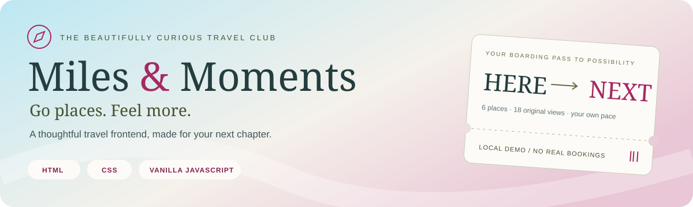
</p>

<p align="center">
  <strong>Six destinations. Eighteen original views. A little room for wonder.</strong><br>
  A responsive travel website with guest browsing, personal itineraries, demo bookings, and an administrator desk.
</p>

<p align="center">
  <a href="#start-here">✦ Start here</a> ·
  <a href="#take-a-peek">▧ Take a peek</a> ·
  <a href="#choose-your-seat">♡ Choose your seat</a> ·
  <a href="#make-it-yours">✎ Make it yours</a> ·
  <a href="#checks-and-confidence">✓ Checks</a>
</p>

> **A friendly heads-up:** this is a frontend learning project. All accounts and records stay in your browser. Flights, stays, prices, and reviews are illustrative; no payments, tickets, reservations, or emails are sent.

## Start here

**You need:** [Node.js 22 or later](https://nodejs.org/en/download) and a current browser. Node includes `npm`, which runs the project commands. [Git](https://git-scm.com/downloads) is needed only for the clone option.

### 1. Get the project

In a terminal, run:

```sh
git clone https://github.com/Cybercipher101/Miles-Moments.git
cd Miles-Moments
```

<details>
<summary><strong>New to Git? Download a ZIP instead.</strong></summary>

On this repository, choose **Code → Download ZIP**, extract it, and open a terminal inside the extracted folder. You should see `package.json`, `README.md`, and `dist/` there. Skip the two commands above.

</details>

### 2. Start the website

```sh
npm start
```

Open **[localhost:5500](http://localhost:5500)**. Keep the terminal running; press **Ctrl+C** to stop it. There is **no install or build step** for simply viewing the site.

### 3. Pick your first chapter

The first screen is **Log in**. Choose **Continue as guest** to look around, **Create an account** to register a traveler, or use a demo account below. New visitors following a direct page link also start at this entry screen.

> Use `npm start`, rather than double-clicking an HTML file. JavaScript modules and password hashing need the local HTTP server.

## Take a peek

Select a gallery below, or open the [visual album](docs/showcase.html) locally for **All / Desktop / Mobile** filters, screen search, and full-size screenshots. Run `npm run preview:docs` and visit **[localhost:5502](http://localhost:5502)**. This optional album needs no dependency install. GitHub displays its HTML source; use the local command for the interactive view.

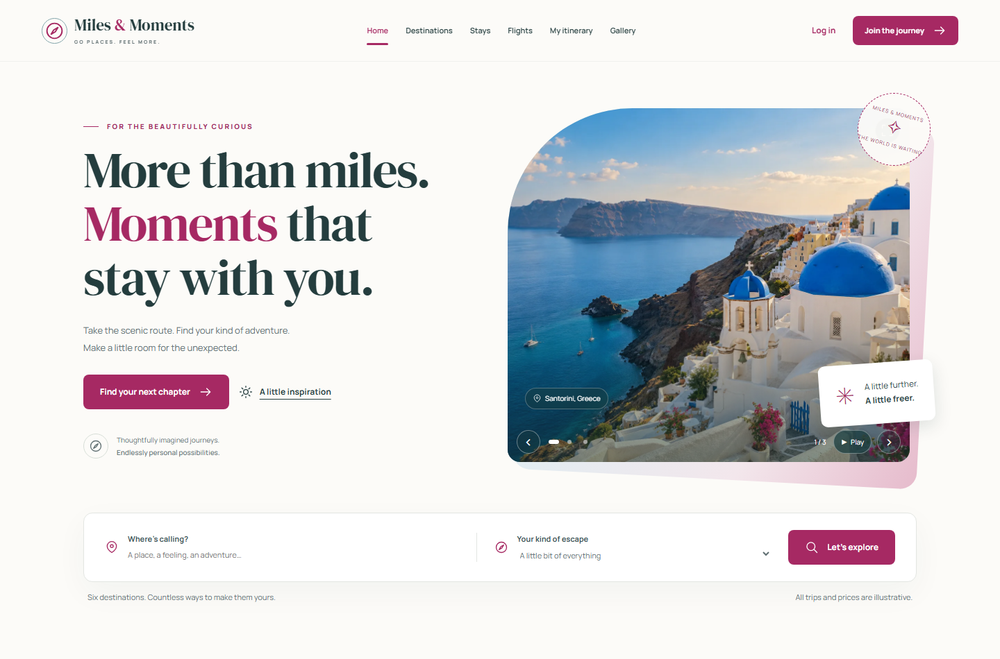

<details>
<summary><strong>☁ Desktop postcards — login, flights, and gallery</strong></summary>

**A welcoming first stop.** Login, registration, and a remembered guest option.

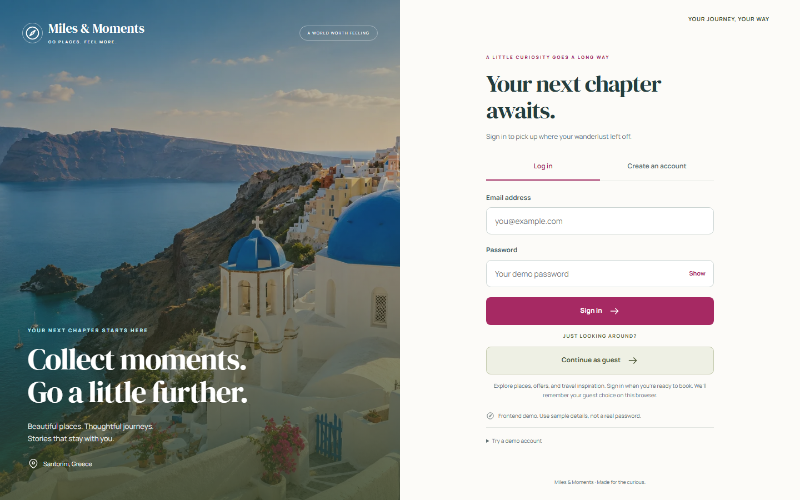

**A window seat to somewhere new.** Scenic flight inspiration and practical search fields.

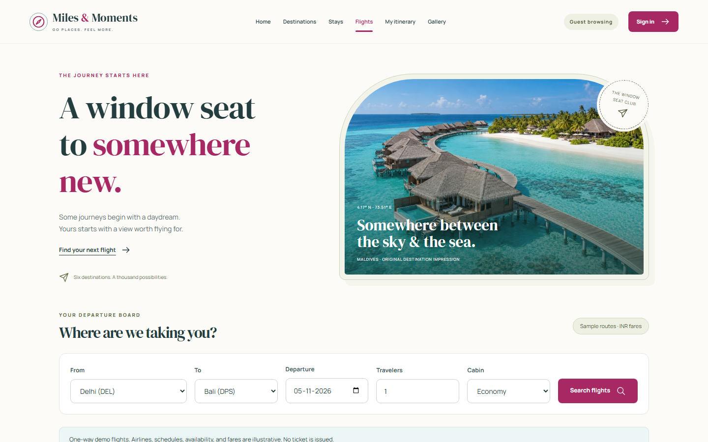

**A closer look.** Editorial photo journals with slideshow and expansion controls.

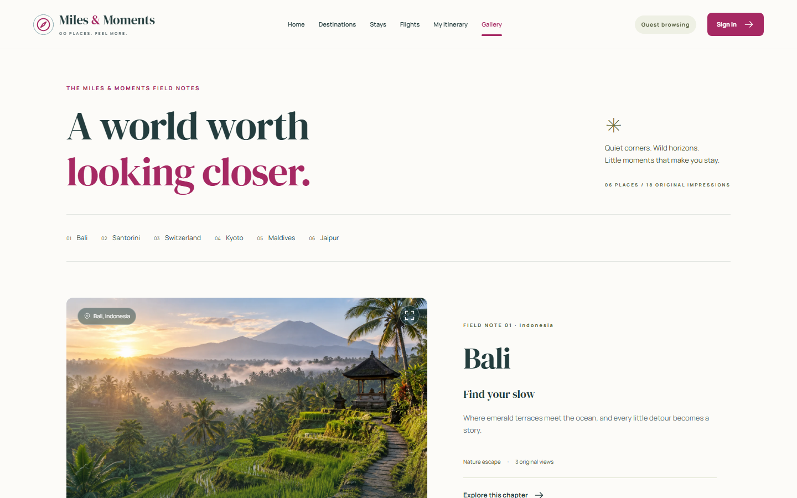

</details>

<details>
<summary><strong>♡ Pocket-sized moments — mobile screens</strong></summary>

<p>
  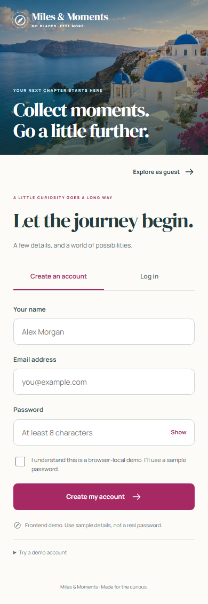
  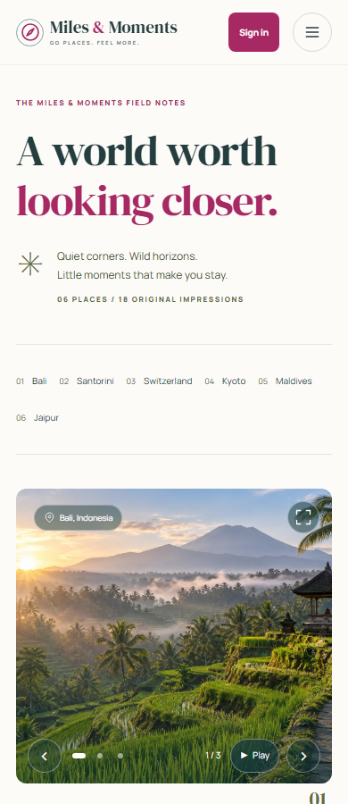
  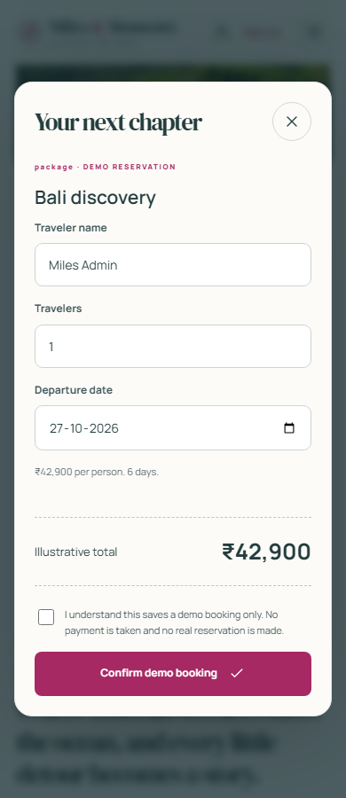
</p>

Layouts were checked at **360, 390, 768, 1024, and 1440 pixels**. These are browser viewport captures, not photos of physical phones.

</details>

<details>
<summary><strong>✦ Behind the desk — booking and administration</strong></summary>

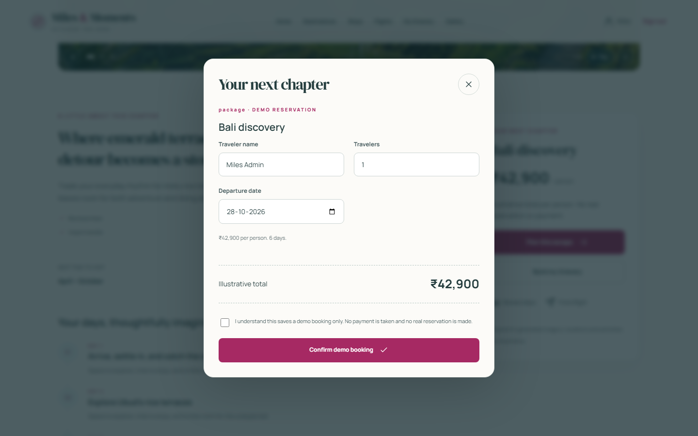

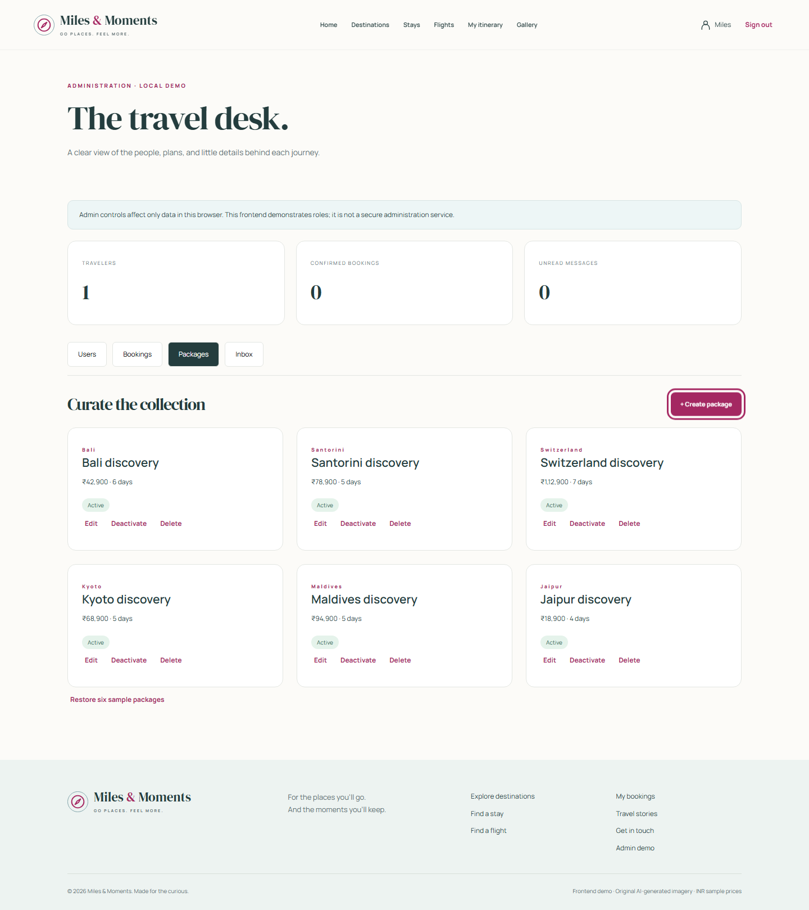

Both roles use the same browser-local dataset. See [visual checks](docs/VISUAL-CHECKS.md) for screenshot dates and coverage.

</details>

## What you can explore

| Your next little adventure | What works |
| --- | --- |
| **Find your somewhere** | Bali, Santorini, Switzerland, Kyoto, Maldives, and Jaipur; destination and activity carousels |
| **Narrow it down** | Text search, category and budget filters, name/price/rating sorting, empty states, reset |
| **Plan the details** | Package inclusions, exclusions, daily plans, amenities, illustrative INR prices |
| **Try a reservation** | Hotel dates and guest counts; flight routes, dates, travelers, and cabins; booking totals and cancellations |
| **Keep a travel journal** | Edit and reorder days and activities, mark completion, save to an account, export text |
| **Collect inspiration** | Eighteen original generated images, galleries, sample reviews, and locally submitted ratings |
| **Leave a little hello** | Contact at the end of Home and on a dedicated page; messages appear in the local admin inbox |

Every content page has a **Home** link. Navigation stays in the same tab. Horizontal carousels keep normal vertical scrolling available.

## Choose your seat

These are public, fictional demo credentials. Use a sample password when creating your own local account.

| Seat | Email | Password | Best for |
| --- | --- | --- | --- |
| **Guest** | No account needed | — | Offers, imagery, and sample plans |
| **Traveler** | `traveler@miles.test` | `Travel123!` | Bookings, saved itineraries, and reviews |
| **Administrator** | `admin@miles.test` | `Admin123!` | Local users, bookings, packages, and messages |

### A traveler’s first five minutes

1. Sign in as the demo traveler, or create an account.
2. Open **Destinations**, try the search and filters, then explore a place.
3. Open its package, choose **Plan this escape**, review the total, and confirm a **demo** booking.
4. Open **My Bookings** to see the record or try cancellation.
5. Add an activity to **My itinerary**, edit the plan, and export it as text.

Guests can compare offers and search inventory. Booking forms, My Bookings, saved itinerary actions, and review submission require login, then return to the intended page. The guest choice persists across pages and tabs in the same browser. Signing out clears it and returns to login.

### A little understanding between traveler and admin

Travelers manage their own bookings and saved plans. Administrators manage local user activation, booking status, package creation/editing/removal, and contact submissions. New registrations always create **travelers**.

Try this: submit a message through **Contact**, sign out, sign in as the administrator, then open **Inbox**. The message is there because both roles use the same browser and website address—not because an email was delivered. An administrator on another device will not see it.

## Find your way around the code

```text
Miles-Moments/
├── dist/                      The actual website; no build step
│   ├── *.html                 15 page entrypoints
│   ├── assets/
│   │   ├── styles.css         Shared layout, forms, responsive styles
│   │   ├── experience.css     Olive accents, photo journals, reveals
│   │   ├── images/            18 original WebP images
│   │   └── fonts/             Local fonts and licenses
│   └── js/                    Vanilla JavaScript modules
├── scripts/                   Local servers and source/documentation checks
├── tests/                     Unit and browser tests
├── docs/                      Planning, design, screenshots, visual album
└── README.md                  You are here ♡
```

**HTML** provides real page entrypoints. **CSS** controls appearance and responsive layouts. **Vanilla JavaScript** assembles page markup and handles interactions. There is no runtime framework or application backend. Despite its name, `dist/` is authored source; `.gitattributes` ensures GitHub counts its HTML, CSS, and JavaScript correctly.

<details>
<summary><strong>Page-by-page guide</strong></summary>

| File in `dist/` | What it opens |
| --- | --- |
| `index.html`, `login.html` | Login and guest entry |
| `register.html` | Traveler registration |
| `home.html` | Introduction, chapter links, discovery, reviews, contact |
| `destinations.html` | Search, filters, sorting, carousels |
| `destination.html?id=bali` | Destination details and immersive gallery |
| `package.html?id=bali` | Inclusions, daily plan, demo booking |
| `hotels.html`, `flights.html` | Sample inventory search and booking |
| `itinerary.html` | Personal plan and text export |
| `gallery.html`, `reviews.html` | Visual inspiration and stories |
| `bookings.html` | Signed-in account’s bookings |
| `contact.html` | Local contact submission |
| `admin.html` | Administrator dashboard |

</details>

## Make it yours

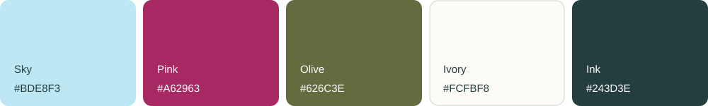

The website pairs **DM Serif Display** headings with **Manrope** interface text, stored locally with SIL Open Font licenses. GitHub supplies the README’s reading font; the banner and palette provide a portable visual identity.

| Want to change… | Start here |
| --- | --- |
| Colors, spacing, buttons, mobile layout | [`styles.css`](dist/assets/styles.css), especially `:root` |
| Transitions, olive details, photo journals | [`experience.css`](dist/assets/experience.css) and [`motion.js`](dist/js/motion.js) |
| Destinations, prices, activities | [`data.js`](dist/js/data.js) |
| Page content and navigation | [`pages.js`](dist/js/pages.js) and [`ui.js`](dist/js/ui.js) |
| Login, guest access, local records | [`store.js`](dist/js/store.js) and [`app.js`](dist/js/app.js) |
| Booking and itinerary interactions | [`actions.js`](dist/js/actions.js) |
| HTML titles or metadata | [`create-pages.mjs`](scripts/create-pages.mjs), then `node scripts/create-pages.mjs` |

Edit, save, and refresh the browser. Preserve visible keyboard focus and reduced-motion support. Slideshows pause offscreen and in background tabs; scroll reveals and autoplay respect the user’s motion preference.

## Checks and confidence

Simply opening the site needs no dependencies. To run development tests:

```sh
npm ci
npx playwright install chromium
npm test
npm run check
npm run check:docs
npm run test:browser
```

| Command | In plain language |
| --- | --- |
| `npm ci` | Install the exact development dependencies from the lockfile |
| `npm test` | Check pricing, dates, filtering, and other pure logic |
| `npm run check` | Check JavaScript syntax, HTML metadata, and required images |
| `npm run check:docs` | Check README links, artifacts, and visual-album references |
| `npm run test:browser` | Exercise flows and responsive layouts in Chromium; starts the app server if needed |
| `npm run preview:docs` | Open the filterable visual album at localhost:5502 |

**Application checks, 21 October 2026:** 6 unit tests and 23 browser tests passed. **Documentation and visual review, 22 October 2026:** see [visual checks](docs/VISUAL-CHECKS.md). These are dated records, not live CI badges. Browser automation uses Chromium; physical phones, Safari/Firefox, and a formal accessibility audit remain unverified.

<details>
<summary><strong>Small visual checklist to try yourself</strong></summary>

- [ ] At a narrow width, text fits without unintended sideways scrolling.
- [ ] Menu, Sign in, gallery arrows, and booking controls remain reachable.
- [ ] Tab shows a focus outline; Escape closes an expanded gallery or dialog.
- [ ] Combined search/filter choices update results; Reset restores them.
- [ ] Reduced motion disables decorative movement and gallery autoplay.
- [ ] Contact is the final Home section before the footer.

These empty boxes are a manual checklist, not claims of completed device testing.

</details>

## A little help when things go sideways

| What you see | What to try |
| --- | --- |
| “npm is not recognized” | Install Node.js, reopen the terminal, run `node --version` and `npm --version`. |
| Missing `package.json` | Open the terminal in the extracted/cloned project folder. |
| `EADDRINUSE` / port already in use | Use the existing project server, stop it with Ctrl+C in its terminal, or choose another port below. |
| Blank page after double-clicking HTML | Run `npm start` and open the localhost link. |
| Missing account or booking | Use the same browser, profile, hostname, and port. Different origins have separate storage. |
| Storage recovery banner | Allow browser storage. **Reset demo storage** deletes this project’s local records and guest preference; use it only for a fresh demo. |
| Playwright browser missing | Run `npx playwright install chromium` after `npm ci`. |

<details>
<summary><strong>Use a different website port</strong></summary>

PowerShell:

```powershell
$env:PORT = '5503'
npm start
```

macOS / Linux:

```sh
PORT=5503 npm start
```

Open `http://localhost:5503`. Browser tests expect port 5500; use the default port for those tests. The documentation album uses port 5502.

</details>

## A small automation desk

The three suggested GitHub Actions workflows are ready: **Publish Node.js Package to npm**, **Publish Node.js Package to GitHub Packages**, and **SLSA Generic generator**. Open [Actions](https://github.com/Cybercipher101/Miles-Moments/actions), choose a workflow, and run it on `main`.

Both publishing workflows start with **Preview the package without publishing** checked. They produce an inspectable archive; npm publishing additionally needs your npm package's trusted-publisher setup. SLSA creates provenance for its own archive. These workflows distribute files and keep the website's local-preview setup intact.

See the [beginner workflow guide](docs/WORKFLOWS.md) for setup, package versions, downloads, and limits. To preview an archive locally, run `npm run package:preview`; to test packaging, run `npm run test:package`. No package has been published by this update.

## The project notebook

| Curious about… | Read this |
| --- | --- |
| What the website should do | [PRD](docs/PRD.md) · [MVP](docs/MVP.md) |
| How visitors move through it | [App flow](docs/APP-FLOW.md) |
| How it is built | [Tech stack](docs/TECH-STACK.md) · [Architecture](docs/ARCHITECTURE.md) |
| Colors, typography, interactions | [UI/UX guide](docs/UI-UX.md) |
| What was tested | [Testing](docs/TESTING.md) · [Visual checks](docs/VISUAL-CHECKS.md) |
| Manual publishing and provenance | [GitHub Actions guide](docs/WORKFLOWS.md) |
| Decisions to preserve | [Project memory](docs/MEMORY.md) |
| Image origins | [Image provenance](docs/IMAGE-PROVENANCE.md) |
| Editable layouts and differences | [Figma handoff](docs/FIGMA.md) · [Open Figma](https://www.figma.com/design/RhMcGbJ8l4bVz4xKMs9S78?node-id=5-84) |

Figma contains sixteen editable desktop/mobile compositions. Later login-first, olive, flights, gallery, and motion updates have not been resynchronized to Figma; its outer title still uses the provisional name. Code and screenshots document the current site.

Passwords use salted PBKDF2 digests, but browser-only authentication and admin checks cannot secure production data. There is no cross-device synchronization or live booking fulfillment. The project is for **local preview**; no GitHub Pages or Sites deployment is configured.

<p align="center"><strong>Made for the curious. Built one chapter at a time.</strong><br><a href="#start-here">Back to your first step ↑</a></p>
